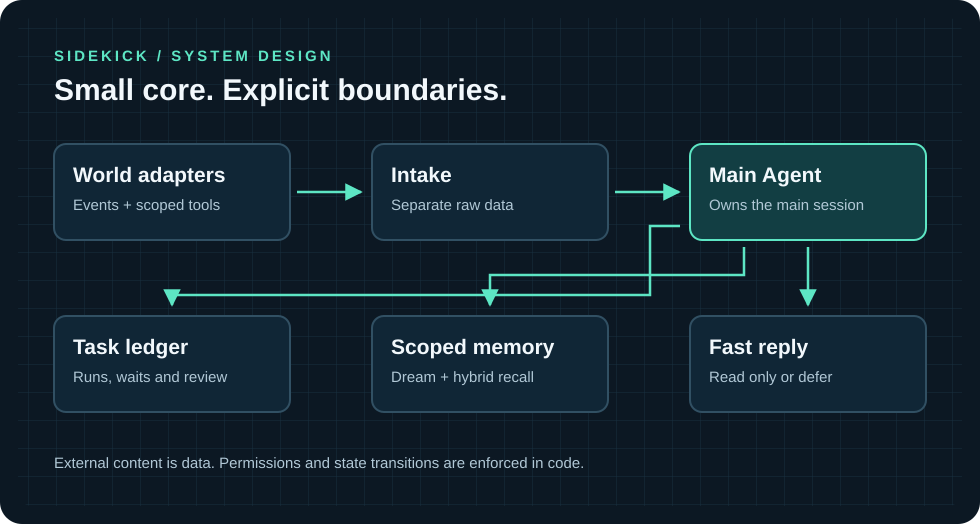

# Sidekick: a personal agent you can rewrite

[简体中文](README.md) · [Design notes (中文)](docs/design.md) · [Launch copy](launch/copy.md)

**One front door. Permissions on your terms. Source you can keep changing.** This repository documents lessons from building Sidekick and includes a runnable reference core. It is not an installer for the original deployment.

General-purpose assistants are useful out of the box. Personal workflows, however, span devices, OS permissions, and private context. A platform cannot assume broad access or build the last mile for every user. Sidekick's bet is a small agent loop, replaceable Worlds for data and tools, and source-level customization with a capable coding model. Reviewable changes, tests, and rollback still matter; self-evolution is not an excuse for unreviewed deployment.



| Problem | Design |
| --- | --- |
| Each new integration changes the agent | Worlds package events and scoped tools behind explicit boundaries |
| Questions stall behind long turns | A bounded, read-only `fastReply` branch can reuse the main request prefix or hand back to the main loop |
| A large window turns into a noisy archive | Keep a hot prefix and role-scoped memory; consolidate at night and combine lexical with semantic retrieval |
| Dispatched tasks disappear into chat | Track waiting, review, and completion separately in a task ledger |

## Run the reference core

Use Node.js 22 or later. No dependencies, network access, or model keys are needed:

```sh
npm run demo
npm test
```

The synthetic workshop example routes a deduplicated event, pauses and resumes a task after a quota limit, reviews the result, answers a read-only question, and archives old notes before consolidation. The reference core re-expresses the design without copying deployment code. It does not include device adapters, real data, a model gateway, or durable storage. The [design notes](docs/design.md) distinguish the original system from the example.

## Review status

Private review draft. Publication and licensing are pending maintainer review; see [release review](docs/release-review.md).
