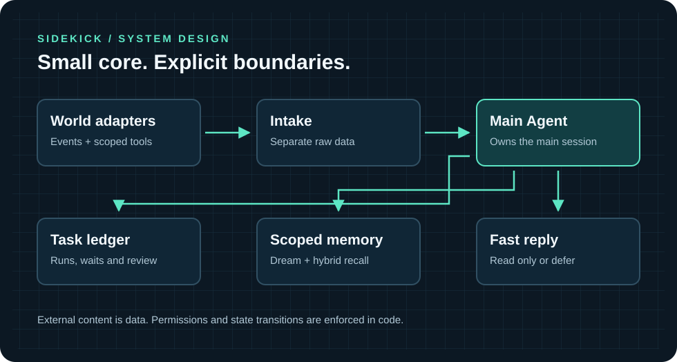

# Sidekick: a personal agent you can rewrite

English · [简体中文](README.zh-CN.md) · [Design notes](docs/design.md) · [Lessons](docs/lessons.md) · [Deploy skill](skills/sidekick-bootstrap/SKILL.md) · [Launch copy](launch/copy.md) · [LINUX DO](https://linux.do)

**One front door. Permissions on your terms. Source you can keep changing.** Sidekick is a personal agent built as extension packages on the open-source agent runtime [Cortico](https://github.com/Pal-AI-Lab/Cortico). This repository shares what is portable: the design, the pitfalls we hit, a runnable reference core, and an agent-facing skill that walks you through building your own. It is not an installer for the original deployment.

General-purpose assistants are useful out of the box. Personal workflows, however, span devices, OS permissions, and private context. A platform cannot assume broad access or build the last mile for every user. Sidekick's bet is a small agent loop, replaceable Worlds for data and tools, and source-level customization with a capable coding model. Reviewable changes, tests, and rollback still matter; self-evolution is not an excuse for unreviewed deployment.

## Quick Start

Paste this into Claude Code, Codex, OpenCode, Pi, or any coding agent, in an empty working directory:

```text
Clone https://github.com/Cznorth/sidekick-open, read AGENTS.md and skills/sidekick-bootstrap/SKILL.md,
then follow the skill phase by phase to build my own Sidekick-style personal agent on Cortico.
Interview me first, ask before any permission, key, login, open port or write-capable tool,
and stop at each checkpoint for my review.
```

The agent clones the repo, runs the reference core, sets up [Cortico](https://github.com/Pal-AI-Lab/Cortico), and builds your own bot and first read-only World with tests, stopping at each checkpoint. A longer version that spells out phases 0 to 3 and the safety rules is in [`PROMPT.md`](skills/sidekick-bootstrap/PROMPT.md) (English and Chinese).

**Install as a skill** so the agent picks it up whenever you say "set up Sidekick":

```sh
git clone https://github.com/Cznorth/sidekick-open
# Claude Code: user-level (or .claude/skills/ inside a project)
cp -r sidekick-open/skills/sidekick-bootstrap ~/.claude/skills/
```

Then tell Claude Code: `Use the sidekick-bootstrap skill to build my own personal agent.` Codex and other agents find the skill through [`AGENTS.md`](AGENTS.md) when started inside the cloned repo. Read [docs/lessons.md](docs/lessons.md) (44 pitfalls) before you wire real devices.



| Problem | Design |
| --- | --- |
| Each new integration changes the agent | Worlds package events and scoped tools behind explicit boundaries |
| Raw device data floods the main conversation | A cheap intake model filters raw data; only what matters reaches the secretary |
| Questions stall behind long turns | A bounded, read-only `fastReply` branch can reuse the main request prefix or hand back to the main loop |
| A large window turns into a noisy archive | Keep a hot prefix and role-scoped memory; consolidate at night and combine lexical with semantic retrieval |
| Dispatched tasks disappear into chat | Track waiting, review, and completion separately in a task ledger |
| "Add a feature" requires the owner to code | The secretary relays the user's own words to a coding executor that edits, tests, commits, and can roll back |

## Layering

```
raw device data (phone, mail, computer, health)
   │  intake: a cheap model filters, merges, forwards only what matters
   ▼
secretary: the main bot, the only one that talks to the user, dispatches work
   │  task brief + the user's original words
   ▼
coding executors (Claude Code, Codex, OpenCode, Pi, ...): edit, test, commit, deploy
```

**Model choice (author's experience, not a benchmark).** The secretary currently runs on a 1M-context Gemini. In the author's day-to-day use, Gemini generalizes clearly better than Claude Opus 5.5 for this role and proactively does things without being asked twice; he considers it the best model for a personal agent right now. Intake runs on cheaper models with a fallback chain; heavy code changes go to coding agents as executors. Your mileage will differ: keep the provider swappable.

## Run the reference core

You do not need this to build your own; the bootstrap prompt runs it first. To try it yourself, use Node.js 22 or later. No dependencies, network access, or model keys are needed:

```sh
npm run demo
npm test
```

The synthetic workshop example routes a deduplicated event, pauses and resumes a task after a quota limit, reviews the result, answers a read-only question, and archives old notes before consolidation. The reference core re-expresses the design without copying deployment code. It does not include device adapters, real data, a model gateway, or durable storage. The [design notes](docs/design.md) distinguish the original system from the example.

## What is in this repository

| Path | Content |
| --- | --- |
| `docs/design.md` / `docs/design.zh-CN.md` | Design notes (English / Chinese) |
| `docs/lessons.md` / `docs/lessons.zh-CN.md` | Pitfalls and habits, each as problem → what happened → rule |
| `docs/architecture.svg` | Architecture diagram |
| `core/` | Dependency-free reference core and tests |
| `skills/sidekick-bootstrap/` | Agent-facing bootstrap skill (`SKILL.md`, `SKILL.zh-CN.md`) and a starter prompt (`PROMPT.md`) |
| `launch/` | Video storyboard, motion source and launch copy (synthetic material only) |

Not included: the private device adapters, Android companion app, Windows agent, prompts, deployment config, or any personal data.

## Friend links

- [LINUX DO](https://linux.do): thanks to the LINUX DO community, where this project is shared and discussed.

## Contributing and license

See [CONTRIBUTING.md](CONTRIBUTING.md) and [docs/release-review.md](docs/release-review.md). Licensed under the [MIT License](LICENSE).
