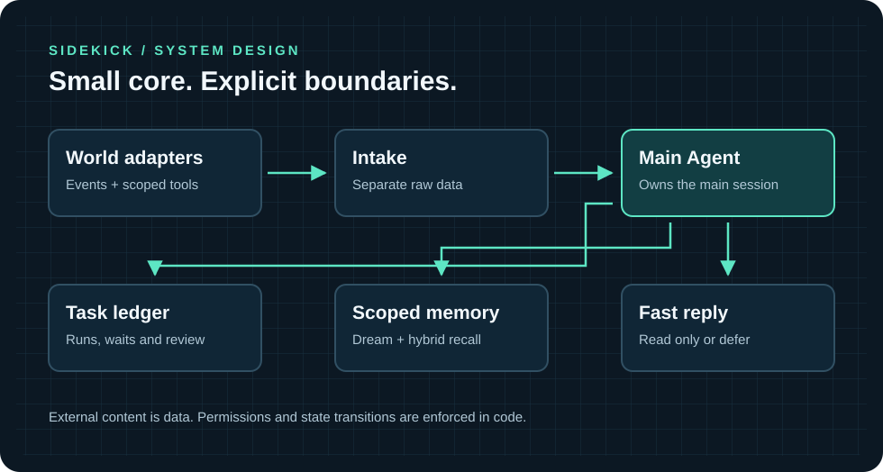

# Sidekick：能被你改写的 Personal Agent

[English](README.md) · 简体中文 · [设计手册](docs/design.zh-CN.md) · [踩坑与习惯](docs/lessons.zh-CN.md) · [搭建 Skill](skills/sidekick-bootstrap/SKILL.zh-CN.md) · [发布文案](launch/copy.md)

**入口做统一，权限由个人决定，代码可以一直改。** Sidekick 是以扩展包形式搭在开源 Agent 运行时 [Cortico](https://github.com/Pal-AI-Lab/Cortico) 上的个人 Agent。本仓库公开能迁移的部分：设计、踩过的坑、能跑的核心参考代码，以及一份交给 Coding Agent 用的部署 Skill，帮你搭自己的那一套。它不是原部署的安装包。

通用助手擅长提供开箱即用的体验。但真正贴身的工作常跨设备、系统权限和私人上下文；平台不能默认获得这些权限，也很难替每个人定制到底。我们的取舍是让事件循环尽可能小，把数据接入和工具放到可替换的 World 里，再用强 Coding 模型维护属于自己的那一层源码。能改源码不等于允许模型随意上生产：变更仍要可审阅、可测试、可回退。



| 断点 | 设计选择 |
| --- | --- |
| 一接新设备就要改 Agent | World 把输入变成带来源的事件，把工具权限放在适配器边界 |
| 原始设备数据淹没主对话 | 便宜模型做收发室先过滤，只把要紧的转给秘书 |
| 主循环忙时，追问也排队 | `fastReply` 尝试复用主会话请求前缀，限时、只读；答不了就还给主循环 |
| 长会话被噪声淹没 | 热上下文、夜间整理、关键词与语义混排、按角色隔离记忆分片 |
| 派单之后，聊天没动静就像烂尾 | 任务账本区分等待、待验收和完成；执行器结束不等于用户验收 |
| 加个功能还得自己写代码 | 秘书把用户原话转给 Coding 执行器，由它改、测、提交，出问题能回退 |

## 分层

```
原始数据（手机、邮箱、电脑、健康）
   │ 收发室：便宜模型清洗归并，只转要紧的
   ▼
秘书：主 Bot，唯一和用户说话的入口，负责派活
   │ 任务书 + 用户原话
   ▼
Coding 执行器（Claude Code、Codex、OpenCode、Pi 等）：改代码、测试、提交、部署
```

**模型选择（作者个人经验，不是评测结论）。** 秘书现在用 1M 上下文的 Gemini。作者日常使用下来，Gemini 在这个角色上的泛化能力明显好于 Claude Opus 5.5，而且会主动把事办了，不用催第二遍；他认为它是目前做个人 Agent 最合适的模型。收发室用更便宜的模型并配回退链；重的代码活交给 Coding Agent 当执行器。每个人的体验会不同，provider 要保持可替换。

## 跑一遍

需要 Node.js 22 或以上。无需安装依赖、联网或填模型密钥：

```sh
npm run demo
npm test
```

演示使用合成的工作坊任务：事件去重 → 执行器遇到限额暂停 → 恢复并提交成果 → 验收 → 忙时只读查询 → 归档整理。`core/` 是依据内部设计重新编写的参考实现：**没有原适配器、部署配置、私人数据、模型调用或持久化服务**。原系统行为与示例取舍的差别见[设计手册](docs/design.zh-CN.md)。

## 搭你自己的

把 [`skills/sidekick-bootstrap/SKILL.md`](skills/sidekick-bootstrap/SKILL.md) 交给一个 Coding Agent（Claude Code 会当作 Skill 加载；Codex 等经 [`AGENTS.md`](AGENTS.md) 找到它）。它会带你从零在 Cortico 上搭出自己的 Sidekick 式 Agent：哪些已经有、哪些要自己写、按什么顺序写、怎么验收、有哪些安全规矩。也可以直接把 [`PROMPT.md`](skills/sidekick-bootstrap/PROMPT.md) 里的引导 Prompt 粘给你自己的 Agent。接真设备之前先读 [踩坑与习惯](docs/lessons.zh-CN.md)。

## 仓库里有什么

| 路径 | 内容 |
| --- | --- |
| `docs/design.md` / `docs/design.zh-CN.md` | 设计手册（英文 / 中文） |
| `docs/lessons.md` / `docs/lessons.zh-CN.md` | 踩坑与习惯，每条按「问题 → 经过 → 规矩」写 |
| `docs/architecture.svg` | 架构图 |
| `core/` | 无依赖的参考核心与测试 |
| `skills/sidekick-bootstrap/` | 给 Agent 用的搭建 Skill（`SKILL.md`、中文 `SKILL.zh-CN.md`）和引导 Prompt（`PROMPT.md`） |
| `launch/` | 视频分镜、动效源码与发布文案（全是合成素材） |

不包含：私有的设备适配器、安卓伴生 App、Windows 端采集程序、提示词、部署配置和任何个人数据。

## 贡献与许可

见 [CONTRIBUTING.md](CONTRIBUTING.md) 和 [发布审阅](docs/release-review.zh-CN.md)。以 [MIT 协议](LICENSE) 发布。
